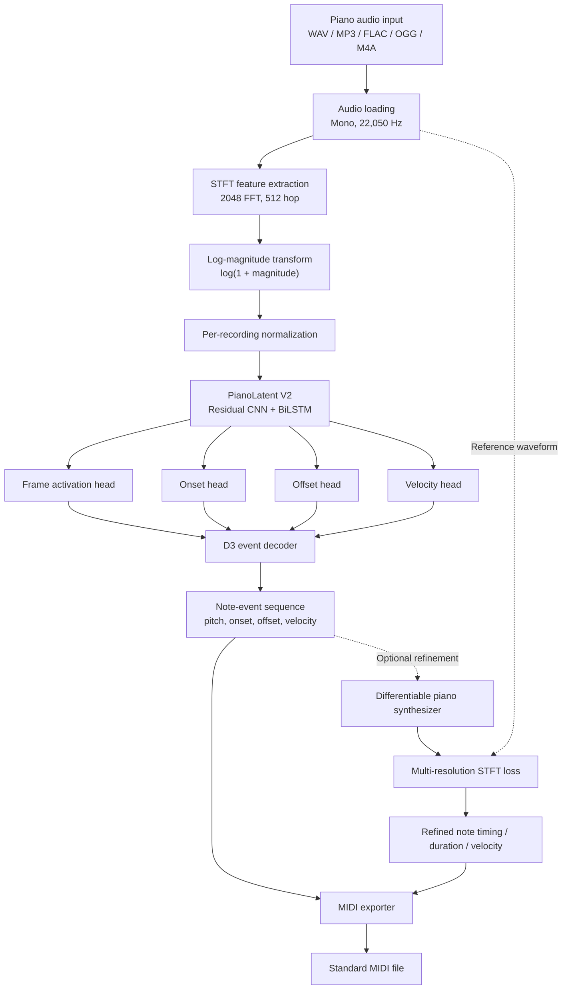
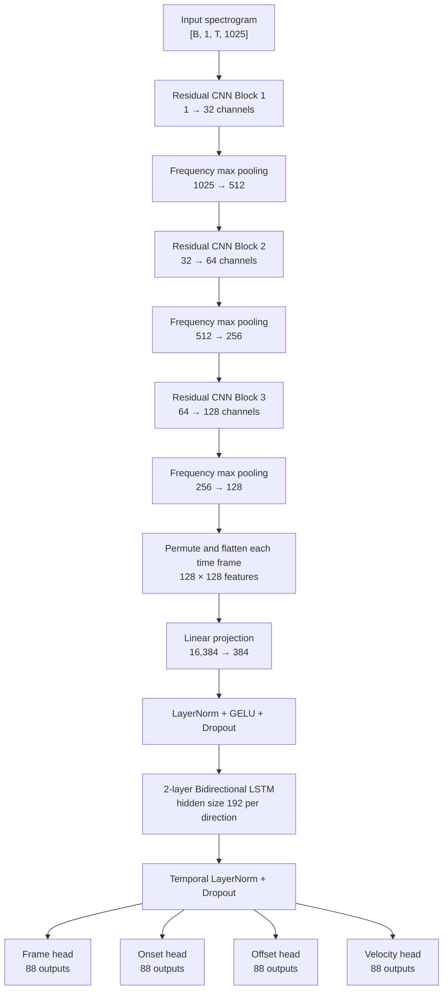

# PianoLatent

**PianoLatent** is a piano audio-to-MIDI transcription system. It takes a recorded piano performance, estimates the notes and their musical attributes, and exports the transcription as a Standard MIDI file.

The current transcription model is **PianoLatent V2**, a residual convolutional recurrent neural network (Residual CNN + BiLSTM) trained using paired audio and MIDI data from the **MAESTRO v3.0.0 dataset**.

> This README documents the currently implemented V2 system. It does not describe the earlier V1 model or unfinished research directions.

---

## Contents

- [What the system does](#what-the-system-does)
- [System architecture](#system-architecture)
- [End-to-end transcription pipeline](#end-to-end-transcription-pipeline)
- [PianoLatent V2 model architecture](#pianolatent-v2-model-architecture)
- [Audio representation and preprocessing](#audio-representation-and-preprocessing)
- [Prediction heads](#prediction-heads)
- [D3 note-event decoding](#d3-note-event-decoding)
- [MAESTRO dataset and training](#maestro-dataset-and-training)
- [Differentiable piano synthesizer](#differentiable-piano-synthesizer)
- [Optional reconstruction refinement](#optional-reconstruction-refinement)
- [MIDI export](#midi-export)
- [Current evaluation](#current-evaluation)
- [Application interface](#application-interface)
- [Project components](#project-components)
- [Running the application](#running-the-application)
- [Limitations](#limitations)

---

## What the system does

PianoLatent performs **polyphonic piano transcription**. Unlike a monophonic pitch detector, it must identify multiple notes that may overlap in time.

For an input piano recording, the system estimates:

- **Pitch:** which piano key was played.
- **Onset:** when the key was pressed.
- **Offset:** when the key was released.
- **Velocity:** the MIDI velocity associated with the note.

The estimated note events are converted into a MIDI file that can be opened in a Digital Audio Workstation (DAW), notation program, or MIDI editor.

The supported piano pitch range is MIDI **21–108** (A0–C8), covering 88 keys.

---

## System architecture

The current system is organized into an audio-transcription path and an optional audio-reconstruction path.



The main transcription path does not require the synthesizer. Reconstruction refinement is an optional secondary stage and is not required to generate a MIDI transcription.

---

## End-to-end transcription pipeline

### 1. Audio input

The application accepts a piano recording in a supported audio format. The waveform is loaded and converted to:

- Sample rate: **22,050 Hz**
- Channels: **mono**
- Data type: floating-point audio samples

Resampling and mono conversion ensure that incoming recordings use the same input convention as the model's training pipeline.

### 2. Time-frequency representation

The waveform is transformed into a Short-Time Fourier Transform (STFT) representation.

| Parameter | Value |
|---|---:|
| Sample rate | 22,050 Hz |
| FFT size | 2,048 |
| Hop length | 512 samples |
| Frequency bins | 1,025 |
| Input representation | Log-magnitude spectrogram |

The STFT represents how spectral energy changes over time. This is useful for piano transcription because different notes produce characteristic harmonic structures, while note attacks and releases produce temporal changes in the spectrum.

### 3. Feature normalization

The magnitude spectrogram is compressed using:

\[
X_{\log} = \log(1 + |STFT(x)|)
\]

The log-magnitude features are normalized per recording:

\[
X_{\mathrm{norm}} =
\frac{X_{\log} - \mu}{\sigma + 10^{-8}}
\]

where \(\mu\) and \(\sigma\) are the mean and standard deviation of the log-magnitude features for that recording.

The resulting feature matrix has the shape:

`[time_frames, 1025_frequency_bins]`

The model receives this as a single-channel tensor with shape:

`[batch, 1, time_frames, 1025]`

### 4. Neural inference

The normalized spectrogram is passed through the trained PianoLatent V2 model. The model produces four time-aligned probability sequences, each covering the 88 piano pitches.

Inference is performed in temporal segments with overlap, then combined to cover the recording.

### 5. Note-event decoding

The four prediction sequences are converted into discrete note events using the D3 decoder. The decoder uses onset, frame-activation and offset evidence to determine note boundaries and uses the velocity prediction to assign note velocity.

### 6. MIDI generation

The decoded events are exported as a Standard MIDI file. Each event contains a MIDI pitch, start time, end time and velocity.

---

## PianoLatent V2 model architecture

PianoLatent V2 uses a **Residual Convolutional Neural Network followed by a Bidirectional Long Short-Term Memory network (Residual CNN + BiLSTM)**.

The convolutional part learns local time-frequency patterns from the spectrogram. The recurrent part models temporal context in both forward and backward directions. This combination is useful because piano notes are identified not only by their instantaneous frequency content, but also by how their spectral energy develops over time.

### Architecture flow



### 1. Residual CNN feature extractor

The CNN consists of three residual blocks:

| Block | Input channels | Output channels | Frequency bins after pooling |
|---|---:|---:|---:|
| Residual block 1 | 1 | 32 | 512 |
| Residual block 2 | 32 | 64 | 256 |
| Residual block 3 | 64 | 128 | 128 |

Each residual block contains:

- Two 2D convolutional layers.
- Batch normalization.
- GELU activation.
- A residual/skip connection.
- Dropout.
- Frequency-axis max pooling.

The skip connection allows the block to combine its learned transformation with the input representation. This supports deeper feature extraction while helping preserve useful lower-level information.

Pooling is applied along the frequency dimension, not the time dimension. This retains the temporal resolution needed for note-boundary prediction while reducing the frequency feature size.

### 2. Feature projection

After the CNN, the feature map for each time frame contains:

`128 channels × 128 frequency positions = 16,384 features`

These features are flattened per time frame and projected into a 384-dimensional representation using a linear layer, Layer Normalization, GELU activation and dropout.

This creates a compact feature sequence for temporal modelling.

### 3. Bidirectional LSTM

The temporal model is a two-layer Bidirectional LSTM:

| Parameter | Value |
|---|---:|
| Number of LSTM layers | 2 |
| Hidden size per direction | 192 |
| Directions | Forward + backward |
| Combined output size | 384 |
| Dropout | 0.20 between recurrent layers |

The forward LSTM learns how a note develops from earlier frames to later frames. The backward LSTM uses later context to help interpret earlier frames.

This context is important for distinguishing note attacks, sustained notes, releases and repeated notes.

### 4. Output heads

The shared temporal representation is sent to four independent prediction heads. Each head outputs 88 values per time frame, one for every piano key from MIDI 21 to MIDI 108.

The model therefore predicts:

- Frame activation probabilities.
- Onset probabilities.
- Offset probabilities.
- Velocity estimates.

The output heads use sigmoid activations, producing values in the range 0–1. Velocity predictions are converted to the MIDI velocity range during event decoding/export.

---

## Audio representation and preprocessing

The model uses a mono log-magnitude STFT rather than raw waveform input.

This representation was selected because:

1. Piano notes contain harmonic structures that are visible in the frequency domain.
2. The spectrogram preserves time evolution through successive frames.
3. Log compression reduces the large dynamic range between strong and weak spectral components.
4. Per-recording normalization reduces sensitivity to overall recording level.

The 2,048-point FFT provides frequency detail, while the 512-sample hop gives a frame interval of approximately **23.22 ms** at 22,050 Hz.

The model predicts at this frame resolution. The D3 decoder converts frame-level outputs into note-level events.

---

## Prediction heads

### Frame activation head

Estimates whether each pitch is active at each time frame. It provides evidence for the duration of a note between its attack and release.

### Onset head

Estimates the probability that a note of a particular pitch begins at each frame. This is used to identify note attacks and separate repeated notes of the same pitch.

### Offset head

Estimates the probability that a note of a particular pitch ends at each frame. This provides note-release evidence for event decoding.

### Velocity head

Estimates the velocity associated with each pitch and time frame. The decoder samples the relevant prediction around a detected note event and maps it to MIDI velocity.

These heads share the same CNN-BiLSTM feature representation but learn different note attributes.

---

## D3 note-event decoding

The neural network produces frame-wise predictions, but a MIDI file requires discrete note events. The **D3 decoder** performs this conversion.

The current application defaults to the following thresholds:

| Decoder parameter | Default |
|---|---:|
| Onset threshold | 0.35 |
| Offset threshold | 0.30 |
| Frame threshold | 0.35 |

The thresholds can be adjusted in the application.

At a high level, decoding uses:

- Onset probability to identify candidate note starts.
- Frame activation to determine where a pitch remains active.
- Offset probability to identify note-release boundaries.
- Velocity prediction to estimate the note's MIDI velocity.

The output is an event list containing:

```text
pitch
onset
offset
velocity
```

The decoder is deterministic given the model predictions and threshold settings. It is separate from the neural network: changing decoder thresholds does not retrain the model.

---

## MAESTRO dataset and training

PianoLatent V2 is trained using **MAESTRO v3.0.0** (MIDI and Audio Edited for Synchronous TRacks and Organization).

MAESTRO is suitable for supervised piano transcription because it provides piano audio recordings paired with corresponding MIDI performances. The aligned audio and MIDI provide the information needed to construct note-level training targets.

### How MAESTRO is used

1. The dataset metadata is read to identify recordings and their official splits.
2. Audio and corresponding MIDI files are paired.
3. Audio is resampled to 22,050 Hz mono.
4. MIDI note events are converted into frame-wise targets for the 88-pitch range.
5. The paired features and targets are stored as processed NPZ files.
6. The model is trained using the training split and evaluated using the validation split.

The training targets represent:

- Frame activity for each pitch.
- Note onset for each pitch.
- Note offset for each pitch.
- Note velocity for each pitch.

Exact MIDI note-event information is also retained during preprocessing so event-level evaluation can use the reference onset, offset, pitch and velocity rather than relying only on frame-quantized labels.

### Official splits

The project preserves MAESTRO's official train/validation/test split labels during preparation. The current reported validation evaluation uses **47 recordings** from the validation split.

The validation recordings are used to measure model performance; they are not used as training examples for the reported baseline.

---

## Differentiable piano synthesizer

The project also contains a differentiable, analytical piano synthesizer. It renders audio from note parameters and provides an approximate piano-like signal for reconstruction experiments.

The renderer models:

- A set of harmonic partials.
- Inharmonicity of piano-string partials.
- Slightly detuned unison strings.
- Velocity-dependent excitation and brightness.
- Attack and decay behaviour.
- Key-release damping.
- Sustain pedal control through MIDI CC64.
- Optional stereo rendering.

The synthesizer is implemented as a differentiable PyTorch module. This allows gradients from an audio reconstruction loss to flow back to continuous note parameters.

**Important:** this is an analytical approximation. It is not a sample-based SoundFont, a commercial piano library, or a complete physical simulation of a piano.

---

## Optional reconstruction refinement

The application includes an optional reconstruction-based refinement stage.

The process is:

1. Run the V2 model to obtain note events.
2. Render those events using the differentiable piano synthesizer.
3. Compare the rendered waveform with the input recording.
4. Calculate multi-resolution STFT reconstruction loss.
5. Optimize selected continuous note parameters.
6. Export the adjusted note events.

The refinement stage currently adjusts:

- Note onset.
- Key-down duration.
- Velocity.

Pitch is held fixed; this stage does not discover missing pitches or independently perform a new transcription. The current refinement path also does not estimate sustain-pedal events from the input recording.

The multi-resolution STFT loss compares spectral representations at multiple time-frequency resolutions. This provides a reconstruction objective that is less dependent on exact sample-by-sample waveform alignment.

Reconstruction loss and transcription accuracy are different objectives. A lower reconstruction loss does **not** automatically mean a higher note-level F1 score. Refinement should therefore be treated as optional and evaluated separately from the base V2 transcription.

---

## MIDI export

The decoded note events are written as a Standard MIDI File.

Each exported note contains:

- MIDI pitch (21–108).
- Start time.
- End time.
- Velocity (1–127).

The MIDI exporter converts the event representation into a MIDI instrument track. The resulting file can be imported into common MIDI-compatible software for playback, editing or notation.

The MIDI tempo map is metadata for playback and editing. The note event times are derived from the transcription timestamps.

---

## Current evaluation

The current V2 checkpoint was evaluated on the 47-recording MAESTRO validation evaluation.

| Metric | Result |
|---|---:|
| Onset precision | 94.14% |
| Onset recall | 84.88% |
| **Onset F1** | **89.27%** |
| Note precision | 70.68% |
| Note recall | 63.73% |
| **Note F1** | **67.03%** |
| Frame F1 | 67.14% |
| Velocity MAE | 6.96 MIDI velocity units |

Evaluation used the D3 decoder with:

- Onset threshold: 0.35
- Offset threshold: 0.30
- Frame threshold: 0.35

These results are the project's current reference baseline, not a guarantee of performance on arbitrary recordings. Results can vary with piano type, room acoustics, recording equipment, background noise, playing style and audio quality.

---

## Application interface

The current application path uses:

- **React + Vite** for the browser interface.
- **FastAPI** for the backend API.
- **PyTorch** for model inference.
- **Librosa** for audio loading and preprocessing.
- **PrettyMIDI** for MIDI-related operations and event export.

The backend accepts an audio upload, runs V2 transcription, optionally invokes reconstruction refinement, and returns a downloadable MIDI file.

The interface exposes transcription controls and supports the optional refinement path. The V2 model checkpoint is loaded by the inference module and cached for reuse.

---

## Project components

The exact folder names may differ depending on how the project is organized locally. The main logical components are:

| Component | Responsibility |
|---|---|
| `main2.py` | V2 model definition, dataset preparation, training, inference, evaluation, decoder and differentiable synthesizer implementation |
| `application/app.py` | FastAPI application and transcription API endpoints |
| `application/crnn_synth.py` | Loads the V2 model/checkpoint and runs audio-to-note-event inference |
| `application/reconstruction.py` | Optional differentiable-synthesis reconstruction refinement |
| `application/midi_exporter.py` | Converts note events into a MIDI file |
| `application/frontend/` | React + Vite user interface |
| `outputs/spectrograms/checkpoints/pianolatent_v2_best.pt` | Trained V2 model checkpoint |
| `data/maestro/` | MAESTRO audio, MIDI, metadata and processed examples |

The trained checkpoint is required to run inference. It is not necessary to include the complete MAESTRO dataset in a public Git repository.

---

## Running the application

### Backend

From the project root, activate the Python environment and install the dependencies used by the project.

Start the API:

```powershell
python -m uvicorn application.app:app --host 127.0.0.1 --port 8000 --reload
```

### Frontend

In a second terminal:

```powershell
cd application/frontend
npm install
npm run dev
```

The frontend's Vite development configuration should proxy `/api` requests to the local FastAPI server.

### Model checkpoint

The inference module expects the V2 checkpoint at:

```text
outputs/spectrograms/checkpoints/pianolatent_v2_best.pt
```

If the checkpoint is stored elsewhere, configure the `PIANOLATENT_CHECKPOINT` environment variable to point to it.

---

## Limitations

- The current model is specialized for piano transcription; it is not a general multi-instrument transcription system.
- The output range is limited to MIDI pitches 21–108.
- The model operates on mono audio at 22,050 Hz.
- Note boundaries are estimated from frame-level predictions and decoder logic; they are not guaranteed to match the exact physical key movement.
- Sustain-pedal transcription is not part of the four-head V2 transcription model.
- Reconstruction refinement uses an approximate analytical piano renderer and should be evaluated independently.
- The validation metrics describe the current MAESTRO validation evaluation, not performance on every piano recording.

---

## Dataset

> Curtis Hawthorne, Andriy Stasyuk, Adam Roberts, Ian Simon, Cheng-Zhi Anna Huang, Sander Dieleman, Erich Elsen, Jesse Engel, and Douglas Eck. **Enabling Factorized Piano Music Modeling and Generation with the MAESTRO Dataset.** International Conference on Learning Representations (ICLR), 2019.

Dataset: [MAESTRO v3.0.0](https://magenta.tensorflow.org/datasets/maestro)

---

## License and dataset terms

Add the project's chosen software license before publishing the repository. Review the MAESTRO dataset terms and any third-party dependency licenses before redistributing dataset files, pretrained weights or bundled assets.
